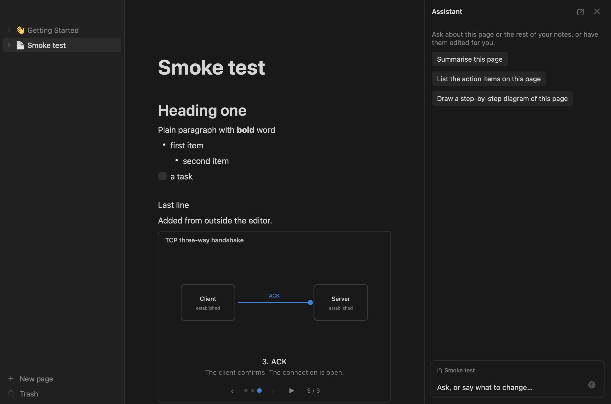
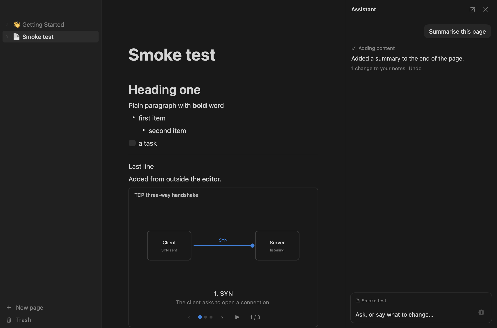

# Flotion

A minimal, native notes app for macOS in the style of Notion, built so that LLMs can read and edit it.

- **Just the core loop.** Nested pages, a block editor, and one SQLite file to keep them in.
- **Native and fast.** SwiftUI and AppKit, no web runtime for the editor. A 5,000-block page opens in under 30 ms.
- **MCP built in.** A bundled server lets Claude Code, Claude Desktop or any MCP client search, read and edit the workspace.
- **Animated diagrams.** An LLM can create a step-through or free-form animated diagram with one tool call and place it in a page.
- **An assistant in the app.** A side panel that knows the open page, and "Edit with AI" on selected text. It runs on your Claude subscription through Claude Code; there is no API key.





## Requirements

macOS 15 or later on Apple Silicon, Xcode 26, and [XcodeGen](https://github.com/yonaskolb/XcodeGen) (`brew install xcodegen`). The assistant also needs [Claude Code](https://code.claude.com/docs/en/setup), signed in.

## Build and run

```bash
./Scripts/verify.sh
```

```bash
open .build/xcode/Build/Products/Debug/Flotion.app
```

`verify.sh` generates the Xcode project, builds everything, and runs the tests and performance budgets. To work in Xcode, run `xcodegen generate` and open `Flotion.xcodeproj`.

## Connect an LLM

**Inside the app:** open Settings, sign in to Claude, then press ⌘J.

**From Claude Code or another MCP client:**

```bash
claude mcp add flotion -- "/path/to/Flotion.app/Contents/MacOS/flotion-mcp"
```

Settings shows this command with the real path filled in.

## Layout

```
App/                        the macOS app: views only
Packages/FlotionKit/
  Sources/FlotionCore/      models, storage, search, Markdown, diagrams
  Sources/FlotionMCP/       MCP tools and transport
  Sources/flotion-mcp/      the MCP server executable
  Sources/FlotionEditor/    view-free editing rules
  Sources/FlotionAI/        Claude Code provider, chat session
  Tests/                    unit, contract and budget tests
Scripts/                    verify.sh, selftest.sh, perftest.sh
Spikes/                     the two timing experiments the design rests on
docs/architecture.md        how the pieces fit, with a diagram
```

## Testing

| Command | Runs |
|---|---|
| `./Scripts/verify.sh` | Package build, all tests, data-layer and MCP budgets, app build |
| `./Scripts/verify.sh --ui` | The above, plus the in-app smoke test and in-app budgets |
| `./Scripts/verify.sh --live-ai` | The above, plus one request to the real, signed-in Claude Code |

The in-app tests type through the real text views and render the window to PNG files in `.build/selftest/`, so they need no accessibility or screen-recording permission.

See [docs/architecture.md](docs/architecture.md) for the design and [CONTRIBUTING.md](CONTRIBUTING.md) for commit and pull request conventions.
