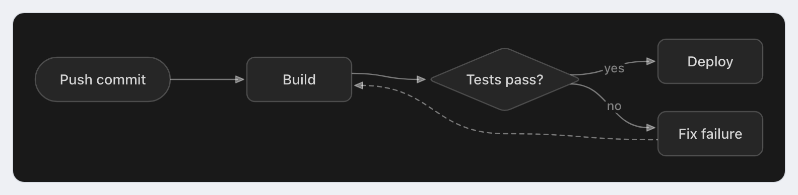
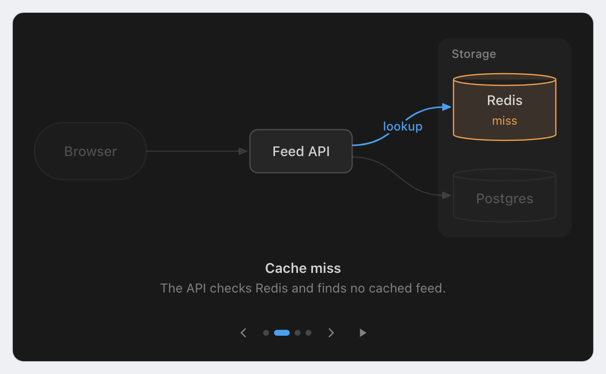
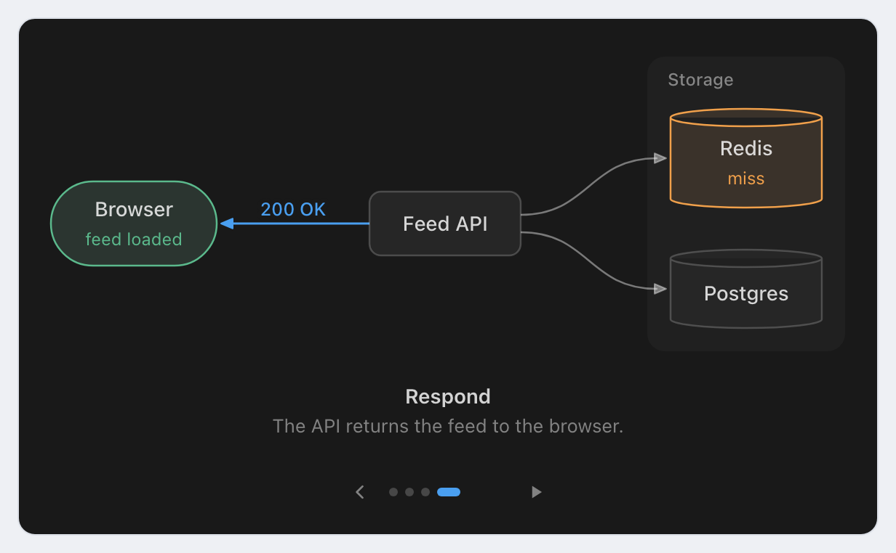
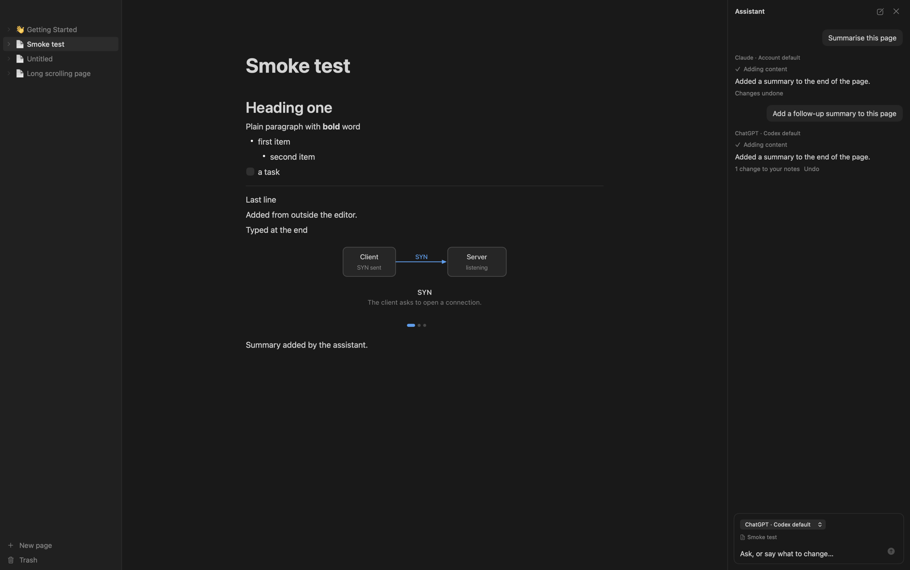

# Flotion

A minimal, native notes app for macOS in the style of Notion, built so that LLMs can read and edit it.

- **Just the core loop.** Nested pages, a block editor, and one SQLite file to keep them in.
- **Native and fast.** SwiftUI and AppKit, no web runtime for the editor. A 5,000-block page opens in under 30 ms.
- **MCP built in.** A bundled server lets Claude Code, Claude Desktop or any MCP client search, read and edit the workspace.
- **Diagrams in your notes.** Flow describes a system and how it changes over time. Flotion lays out the nodes and arrows and plays the steps in the page.
- **An assistant in the app.** A side panel that knows the open page, and "Edit with AI" on selected text. Choose Claude, ChatGPT, or Gemini from the Assistant panel.

## Diagrams with Flow

Flow is Flotion’s line-based language for diagrams. Declare nodes and arrows to draw a still picture, then add `step` blocks if you want to walk through changes. Flotion calculates the layout and keeps node positions fixed as you step through the diagram.

### A release pipeline

The diagram branches at the test result. The dashed arrow shows where the team retries after a failure.



```text
flow right
push: Push commit {shape: pill}
build: Build
test: Tests pass? {shape: diamond}
deploy: Deploy
fix: Fix failure

push -> build -> test
test -> deploy: yes
test -> fix: no
fix -> build {style: dashed}
```

### A feed request with a cache miss

The player can reveal each part of a request in order. These two frames show the cache miss and the response going back to the browser. The `miss` tag and its warning color carry forward after the cache lookup.





```text
flow right
browser: Browser {shape: pill}
api: Feed API
group storage "Storage" {
  redis: Redis {shape: database}
  db: Postgres {shape: database}
}

browser -> api
api -> redis
api -> db

step "Request": The browser asks for its feed.
  send browser -> api: GET /feed

step "Cache miss": The API checks Redis and finds no cached feed.
  focus api, redis
  send api -> redis: lookup
  tag redis: miss
  mark redis: warn

step "Read from storage": The API fetches the feed from Postgres.
  focus api, db
  send api -> db: read feed

step "Respond": The API returns the feed to the browser.
  send api -> browser: 200 OK
  tag browser: feed loaded
  mark browser: good
```

- `flow right` and `flow down` set the layout direction. Declare each node before referencing its ID in an arrow or step.
- `group` draws a boundary around related nodes. `step "Title": caption` adds a frame to the player and starts that step’s list of changes.
- `send` animates a message along an existing arrow in either direction, and `focus` dims the surrounding nodes for that step. Changes made with `tag`, `mark`, `set`, `hide`, and `show` carry forward.

To try an example, open the assistant with ⌘J and ask it to insert a diagram in the current page using the pasted Flow source. From an MCP client, call `create_diagram` with `page_id`, `title`, and the Flow text as `source`.

## Requirements

macOS 15 or later on Apple Silicon, Xcode 26, and [XcodeGen](https://github.com/yonaskolb/XcodeGen) (`brew install xcodegen`).

## Build and run

```bash
./Scripts/verify.sh
```

```bash
open .build/xcode/Build/Products/Debug/Flotion.app
```

`verify.sh` generates the Xcode project, builds everything, and runs the tests and performance budgets. To work in Xcode, run `xcodegen generate` and open `Flotion.xcodeproj`.

## Connect an LLM

**Inside the app:** install [Claude Code](https://code.claude.com/docs/en/setup), [Codex CLI](https://developers.openai.com/codex/cli), or [Gemini CLI](https://geminicli.com/docs/get-started/installation/) for the provider you want to use. Open Settings, select the provider, and enable the models you want in the picker.

- **Claude** uses your Claude Code sign-in.
- **ChatGPT** uses your Codex CLI sign-in with a ChatGPT account.
- **Gemini** uses a separate Gemini CLI profile for Flotion. Click **Sign in to Gemini**, choose **Sign in with Google** in Terminal, and complete the browser flow.

Use **Check again** in Settings after signing in.

Press ⌘J and choose a model above the composer. All three providers can search, read and edit notes in Assistant chat through Flotion's workspace tools. The reply shows tool activity and offers **Undo** for its edits. **Edit with AI** produces a preview you can apply.

Flotion keeps the open chat in memory. After a model switch, your next message sends the selected provider up to 12 recent completed exchanges (about 16 KB of text), plus the current page and selection. A long page can be fetched with the workspace tools. **New Chat** or quitting Flotion clears the app's transcript. The workspace database keeps a separate change log for Undo. Claude Code and Gemini CLI may save their own local session files.



**From Claude Code or another MCP client:**

```bash
claude mcp add flotion -- "/path/to/Flotion.app/Contents/MacOS/flotion-mcp"
```

Settings shows this command with the real path filled in.

## Layout

```
App/                        the macOS app: views only
Packages/FlotionKit/
  Sources/FlotionCore/      models, storage, search, Markdown, diagrams
  Sources/FlotionMCP/       MCP tools and transport
  Sources/flotion-mcp/      the MCP server executable
  Sources/FlotionEditor/    view-free editing rules
  Sources/FlotionAI/        Assistant providers and chat session
  Tests/                    unit, contract and budget tests
Scripts/                    verify.sh, selftest.sh, perftest.sh
Spikes/                     the two timing experiments the design rests on
docs/architecture.md        how the pieces fit, with a diagram
```

## Testing

| Command | Runs |
|---|---|
| `./Scripts/verify.sh` | Package build, all tests, data-layer and MCP budgets, app build |
| `./Scripts/verify.sh --ui` | The above, plus the in-app smoke test and in-app budgets |
| `./Scripts/verify.sh --live-ai` | The above, plus one request to the real, signed-in Claude Code |

The in-app tests type through the real text views and render the window to PNG files in `.build/selftest/`, so they need no accessibility or screen-recording permission. They run in the background: no Dock icon, no visible window, never taking focus, and with their own preferences. Checks that need keyboard focus are listed as `skip`; run `FLOTION_FOREGROUND=1 Scripts/selftest.sh` to watch the run and include them.

See [docs/architecture.md](docs/architecture.md) for the design and [CONTRIBUTING.md](CONTRIBUTING.md) for commit and pull request conventions.
