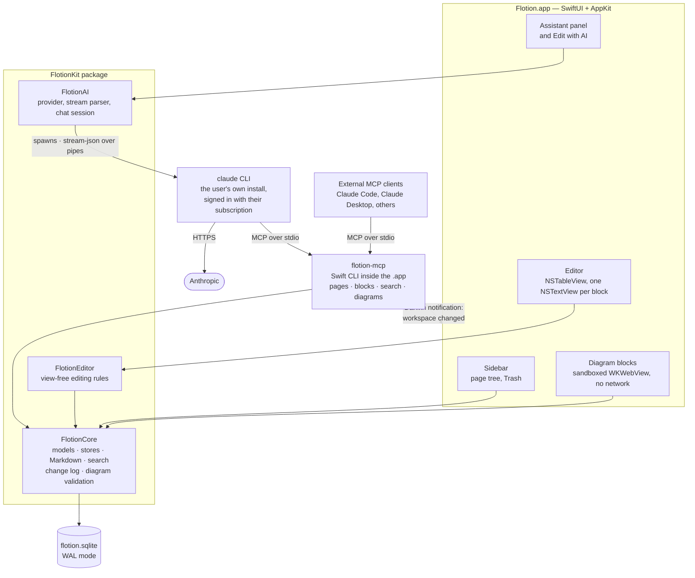

# Architecture

One rule shapes the layout: **all data logic lives in `FlotionCore`, and everything else goes through it.** The app, the MCP server and the in-app assistant are three clients of the same code, so anything the UI can do to a page an LLM can do through the same path.

The in-app assistant is not a second integration. It is the user's own Claude Code, started as a subprocess with only `flotion-mcp` attached: the same server external clients use.

## Processes

| Process | Started by | Talks to |
|---|---|---|
| `Flotion.app` | the user | the database, through `FlotionCore` |
| `flotion-mcp` | an MCP client (Claude Code, or the in-app `claude`) | the same database file; pings the app after each write |
| `claude` | the app, one per request | Anthropic over HTTPS; `flotion-mcp` over stdio |

The app and `flotion-mcp` share one SQLite file in WAL mode. After a write, `flotion-mcp` posts a Darwin notification and the app reloads the changed page, merging block by block so text the user is typing is never overwritten.

## Targets

| Target | Depends on | Holds |
|---|---|---|
| `FlotionCore` | GRDB, swift-markdown | Schema and migrations, page and block stores, full-text search, Markdown codec, change log and undo, diagram validation and HTML template |
| `FlotionMCP` | Core, MCP Swift SDK | The 12 tools, their schemas, and a blocking stdio transport |
| `flotion-mcp` | FlotionMCP | The executable: three lines |
| `FlotionEditor` | Core | `EditorState`: split, merge, indent, reorder, Markdown shortcuts, undo, merging remote changes |
| `FlotionAI` | Core | `AIProvider`, the Claude Code provider, stream-json parser, chat session, prompts |
| `App/` | Core, Editor, AI | Views only |

## Data model

| Table | Purpose |
|---|---|
| `pages` | Tree of pages; `archived_at` is the Trash |
| `blocks` | Flat ordered list per page with a `depth` column. Plain text lives in `plain`; `text` holds JSON runs only when a block has formatting |
| `diagrams` | Diagram source, as a full HTML document or a JSON array of steps |
| `change_log` | Every write made by an AI or MCP client, with before and after, grouped into turns so a turn can be undone |
| `blocks_fts`, `pages_fts` | FTS5 indexes kept in sync by triggers |

## How the assistant is contained

The app never signs in and never sees a credential. It runs the unmodified `claude` binary with:

- `--tools ""`: no built-in tools, so no shell and no file access
- `--strict-mcp-config` with one server, `flotion-mcp`
- `--setting-sources ""` and `--disable-slash-commands`: none of the user's coding setup
- `--permission-mode dontAsk` with only `mcp__flotion` allowed
- an empty working directory, and an environment with no API keys

`FlotionAITests` asserts each of these flags.

## How diagrams are contained

A diagram is LLM-authored HTML, so it is treated as untrusted:

1. `DiagramValidator` rejects external references before anything is stored, which also gives the model a useful error.
2. `DiagramTemplate` adds a Content-Security-Policy of `default-src 'none'` to every document.
3. The web view has a content rule that blocks every network request, a non-persistent data store, and refuses navigation.

The in-app self-test checks that `fetch()` and a remote image both fail inside a diagram.
